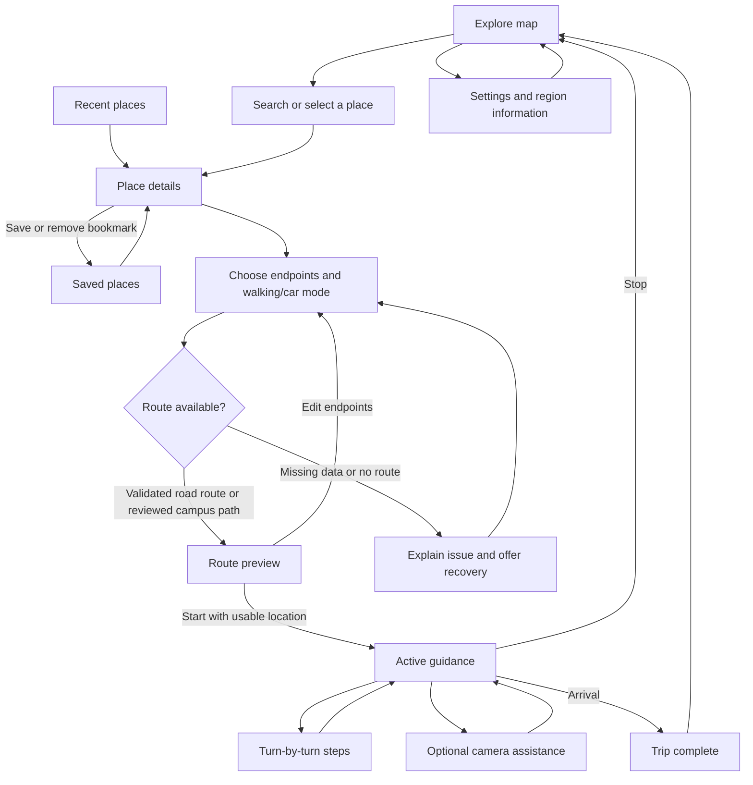

# NavGate

Native Android navigation built with **Kotlin, Jetpack Compose and Material 3**. India-wide offline place discovery and Photon search connect to real Valhalla walking/car routes. Bookmarks, personal itineraries and trip state are stored locally; no paid API key or cloud account is required.

## Features

- MapLibre maps with translucent sheets, place discovery and editable route endpoints.
- A 660,027-record India gazetteer, worldwide Photon search, alias/category ranking, fresh local proximity bias and duplicate handling.
- Saved places, labelled personal itineraries and trip history using Room; preferences using DataStore.
- Valhalla pedestrian/car routing with validated geometry, distance, estimated time and a bounded persistent route cache.
- A* for reviewed campus walking graphs; shared trip state, mode-preserving rerouting, GPS-quality checks and recovery.
- Optional offline text-to-speech and compass-based camera assistance.
- Versioned routing packs with signature validation and trip-pinned data.

## App flow



Map, steps and camera assistance share one navigation session. Saved places, recents and settings remain accessible without a planned route.

## Technology

| Area | Implementation |
| --- | --- |
| Interface | Kotlin, Jetpack Compose, Material 3; dark/daylight/system appearance |
| Maps | MapLibre with OpenFreeMap styles and online map resources |
| Routing | Valhalla pedestrian/auto; local reviewed-campus A*; explicit failure states |
| Persistence | Room bookmarks, itineraries, bounded route cache, history and checkpoints; India SQLite FTS/RTree; DataStore preferences |
| Location | Android framework LocationManager with freshness/accuracy checks |
| Guidance | Shared navigation session, optional installed offline TTS and compass overlay |
| Updates | Bounded signed routing-pack imports with atomic version activation |

The map uses tinted translucent surfaces with an opaque fallback. This is not a claim of true map-backdrop blur.

## Build and test

Requires Android SDK 35, Android 8.0+ (API 26), and a compatible JDK. The project was verified with JDK 22 and targets Java 17 bytecode.

1. Clone the repository and open its root in Android Studio.
2. Install Android SDK 35 and configure a compatible JDK for Gradle.
3. Sync Gradle, select an Android device/emulator, and run the `app` configuration.

From the repository root:

```sh
./gradlew :app:assembleDebug
./gradlew :navigation-core:test :app:testDebugUnitTest
```

With an emulator or device connected:

```sh
./gradlew :app:connectedDebugAndroidTest
```

Debug APK: `app/build/outputs/apk/debug/app-debug.apk`.

Generate the ignored India search asset before building a fresh checkout:

```sh
python3 scripts/build_india_index.py --download
```

For a storage-limited ARM64 emulator, `./gradlew -Pnavgate.abi=arm64-v8a :app:assembleDebug` omits unused native architectures. The default build remains multi-device.

Live public routing tests are opt-in: `NAVGATE_LIVE_ROUTES=true ./gradlew :app:testDebugUnitTest`. The public Valhalla demo is fair-use infrastructure, not a production SLA. See [road navigation](docs/ROAD_NAVIGATION.md) for request limits, provider identification, privacy and self-hosting boundaries.

Additional checks:

```sh
./gradlew :app:lintDebug
python3 -m unittest discover -s scripts/tests -v
```

Keep `local.properties` and signing keys private. Initial dependency resolution requires internet; use `--offline` only after dependencies are cached. Synthetic routing graphs are test fixtures only.

### Verification scope

The earlier frontend integration run recorded **38 app JVM tests, 34 core JVM tests and 13 Android instrumentation tests passing**. Coverage includes routing/session contracts, endpoint selection, bookmark state, trip utility navigation, stale-signal recovery, Room persistence and document-import boundaries. Independent API 34 emulator smoke checks exercised the real map, catalogue search, saved places and settings.

These are results from that recorded run, not a guarantee that every device or future revision passes. Outdoor walking, physical GPS/compass alignment, camera faults, offline audio and complete accessibility acceptance remain outstanding.

## Architecture and repository

`Compose → NavGateViewModel → Kotlin NavigationBackend → local A* / Valhalla → Room / DataStore`

| Directory | Purpose |
| --- | --- |
| `app/` | Android UI, platform adapters, persistence and integration tests |
| `navigation-core/` | Platform-independent geometry, routing, session and pack validation |
| `data/` | Catalogue sources, OSM snapshot, provenance and generated reports |
| `scripts/` | Catalogue generation, candidate extraction and Python regressions |
| `docs/` | Backend contracts, implementation evidence and technical proposal |
| `backend/` | Historical optional Go service; not required by the Android app |

### Data and update rules

- `python3 scripts/build_region_catalog.py` regenerates the information-only catalogue.
- `python3 scripts/build_osm_candidates.py` extracts development graph candidates; it does not approve access or create reviewed entrances.
- Imports validate size bounds, schema, topology, signature and region before switching the active version.
- Local campus trips stay pinned to their graph version. Road trips retain validated provider metadata, mode and shape timing. Imported documents cannot supply their own trusted publisher key.
- Routing packs and map tiles are separate. Installing routing data does not install an offline basemap.

### Permissions and device behavior

Location permission supports current-position selection and foreground guidance. Users can browse and choose endpoints manually without granting it. Camera permission is requested only for optional camera assistance; camera hardware is not mandatory. Internet/network-state access supports map loading and connectivity feedback. Offline speech requires a compatible voice already installed on the device.

[Road navigation and search](docs/ROAD_NAVIGATION.md) · [Backend contracts](docs/BACKEND_INTEGRATION.md) · [Implementation evidence](docs/IMPLEMENTATION_STATUS.md) · [Technical proposal](docs/TECHNICAL_PROPOSAL.md) · [OSM data and attribution](data/osm/README.md)

OSM data is © OpenStreetMap contributors, ODbL. Workbook provenance and redistribution require review. The historical Go service in `backend/` is optional and is not the Android engine's routing fallback.
