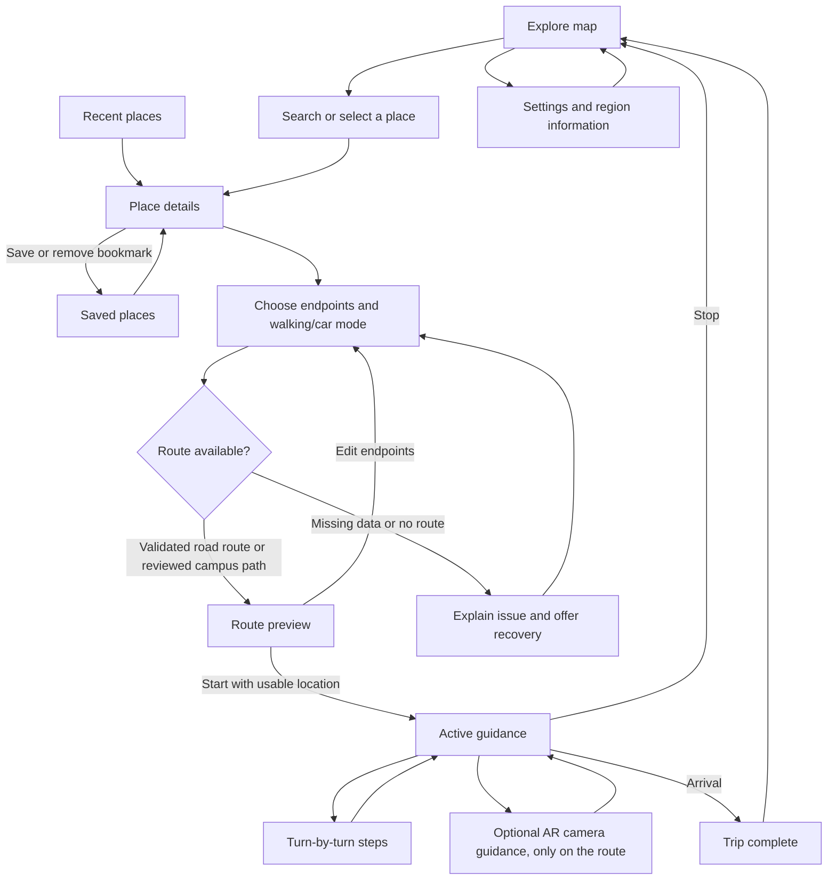

# NavGate

Native Android navigation built with **Kotlin, Jetpack Compose and Material 3**. India-wide offline place discovery and Photon search connect to real Valhalla walking/car routes. Bookmarks, personal itineraries and trip state are stored locally; no paid API key or cloud account is required.

## Features

- MapLibre maps with liquid-glass panels (blurred map behind every sheet and banner), place discovery and editable route endpoints. A **Glass transparency** slider in Settings runs from clear to solid.
- One Google-Maps-style journey UI: Explore, category chips (restaurants, petrol, hospitals, hotels, ATMs and more), results with map pins, place details, car and walking directions with times, and a **2D / 3D / AR** switch on routes (2D flat map, 3D solid buildings, AR camera).
- **AR navigation** on ARCore: a glowing line drawn on the road in the live camera view, ending in a left/right/straight turn marker. AR starts only when you are on the planned route and shows only the road you are on; the next road appears as you reach it. Falls back to the plain camera if ARCore is unavailable.
- Sensor-fused position: GPS plus accelerometer and gyroscope with continuous recalibration, road snapping, a car marker while driving, and a live sensor readout.
- Offline resilience: guidance keeps running without internet, the map along a planned route is saved to the phone, an offline banner points back to the route if you leave it, and rerouting resumes when you reconnect.
- Touch cues before each turn, screen kept awake while guiding, an arrival summary and a one-tap parking spot for car trips.
- A 660,027-record India gazetteer, a 13,163-place offline Mumbai points-of-interest index built from OpenStreetMap (`scripts/build_poi_index.py`), worldwide Photon search, alias/category ranking, fresh local proximity bias and duplicate handling.
- Saved places, labelled personal itineraries and trip history using Room; preferences using DataStore.
- Valhalla pedestrian/car routing with validated geometry, distance, estimated time and a bounded persistent route cache.
- A* for reviewed campus walking graphs; shared trip state, mode-preserving rerouting, GPS-quality checks and recovery.
- Optional offline text-to-speech and ARCore camera guidance.
- Versioned routing packs with signature validation and trip-pinned data.

## App flow



Map, steps and AR camera guidance share one navigation session. Saved places, recents and settings remain accessible without a planned route.

## Technology

| Area | Implementation |
| --- | --- |
| Interface | Kotlin, Jetpack Compose, Material 3; dark/daylight/system appearance; Haze backdrop blur for glass panels |
| Maps | MapLibre with OpenFreeMap styles and online map resources |
| Routing | Valhalla pedestrian/auto; local reviewed-campus A*; explicit failure states |
| Persistence | Room bookmarks, itineraries, bounded route cache, history and checkpoints; India SQLite FTS/RTree; DataStore preferences |
| Location | Android LocationManager with freshness/accuracy checks; Kalman fusion of GPS with accelerometer and gyroscope (`MotionFusion`) |
| AR | ARCore motion tracking at 30 fps, compass and GPS alignment, a checkpoint track that keeps only the current road loaded |
| Guidance | Shared navigation session, optional installed offline TTS, haptic turn cues, offline-safe routing |
| Updates | Bounded signed routing-pack imports with atomic version activation |

Panels blur the map behind them on Android 12 and later and fall back to a tinted surface of the same strength on older phones. The Settings slider controls how see-through they are.

## Build and test

Requires Android SDK 35, Android 8.0+ (API 26), and a compatible JDK. AR navigation needs a phone that supports Google Play Services for AR. The project was verified with JDK 22 and targets Java 17 bytecode.

1. Clone the repository and open its root in Android Studio.
2. Install Android SDK 35 and configure a compatible JDK for Gradle.
3. Sync Gradle, select an Android device/emulator, and run the `app` configuration.

From the repository root:

```sh
./gradlew :app:assembleDebug
./gradlew :navigation-core:test :app:testDebugUnitTest
```

With an emulator or device connected:

```sh
./gradlew :app:connectedDebugAndroidTest
```

Debug APK: `app/build/outputs/apk/debug/app-debug.apk`.

Generate the ignored India search asset before building a fresh checkout:

```sh
python3 scripts/build_india_index.py --download
```

The Mumbai places index is committed. To rebuild it from a Geofabrik extract (no Overpass rate limits), use a Python environment with `osmium` installed:

```sh
python3 scripts/build_poi_index.py --pbf data/osm-extract/western-zone.osm.pbf
```

For a storage-limited ARM64 emulator, `./gradlew -Pnavgate.abi=arm64-v8a :app:assembleDebug` omits unused native architectures. The default build remains multi-device.

Live public routing tests are opt-in: `NAVGATE_LIVE_ROUTES=true ./gradlew :app:testDebugUnitTest`. The public Valhalla demo is fair-use infrastructure, not a production SLA. See [road navigation](docs/ROAD_NAVIGATION.md) for request limits, provider identification, privacy and self-hosting boundaries.

Additional checks:

```sh
./gradlew :app:lintDebug
python3 -m unittest discover -s scripts/tests -v
```

Keep `local.properties` and signing keys private. Initial dependency resolution requires internet; use `--offline` only after dependencies are cached. Synthetic routing graphs are test fixtures only.

### Verification scope

The latest local run passes **87 app JVM tests and 63 core JVM tests**, and the instrumentation suite and screenshot journey passed on a Galaxy S24+ (Android 16, 16 KB pages) before the final round of changes. The AR checkpoint path, offline map download, offline banner, haptic cues and arrival summary were written after that run and have **not yet been exercised on a device**. The earlier frontend integration run recorded **38 app JVM tests, 34 core JVM tests and 13 Android instrumentation tests passing**. Coverage includes routing/session contracts, endpoint selection, bookmark state, trip utility navigation, stale-signal recovery, Room persistence and document-import boundaries. Independent API 34 emulator smoke checks exercised the real map, catalogue search, saved places and settings.

These are results from that recorded run, not a guarantee that every device or future revision passes. Outdoor walking and driving, physical GPS/compass alignment, AR line placement and battery use, offline map coverage, camera faults, offline audio and complete accessibility acceptance remain outstanding. See [remaining work](docs/REMAINING_WORK.md).

## Architecture and repository

`Compose → NavGateViewModel → Kotlin NavigationBackend → local A* / Valhalla → Room / DataStore`

| Directory | Purpose |
| --- | --- |
| `app/` | Android UI, platform adapters, persistence and integration tests |
| `navigation-core/` | Platform-independent geometry, routing, session and pack validation |
| `data/` | Catalogue sources, OSM snapshot, provenance and generated reports |
| `scripts/` | Catalogue generation, candidate extraction and Python regressions |
| `docs/` | Backend contracts, implementation evidence and technical proposal |
| `backend/` | Historical optional Go service; not required by the Android app |

### Data and update rules

- `python3 scripts/build_region_catalog.py` regenerates the information-only catalogue.
- `python3 scripts/build_osm_candidates.py` extracts development graph candidates; it does not approve access or create reviewed entrances.
- Imports validate size bounds, schema, topology, signature and region before switching the active version.
- Local campus trips stay pinned to their graph version. Road trips retain validated provider metadata, mode and shape timing. Imported documents cannot supply their own trusted publisher key.
- Routing packs and map tiles are separate. Installing routing data does not install an offline basemap.

### Permissions and device behavior

Location permission supports current-position selection and foreground guidance. Users can browse and choose endpoints manually without granting it. Camera permission is requested only for optional AR guidance; camera hardware is not mandatory, and AR is offered only while you are on the planned route. Vibration is used for turn cues. Internet/network-state access supports map loading, route saving and connectivity feedback. Offline speech requires a compatible voice already installed on the device.

[Road navigation and search](docs/ROAD_NAVIGATION.md) · [Remaining work](docs/REMAINING_WORK.md) · [Backend contracts](docs/BACKEND_INTEGRATION.md) · [Implementation evidence](docs/IMPLEMENTATION_STATUS.md) · [Technical proposal](docs/TECHNICAL_PROPOSAL.md) · [OSM data and attribution](data/osm/README.md)

OSM data is © OpenStreetMap contributors, ODbL. Workbook provenance and redistribution require review. The historical Go service in `backend/` is optional and is not the Android engine's routing fallback.
