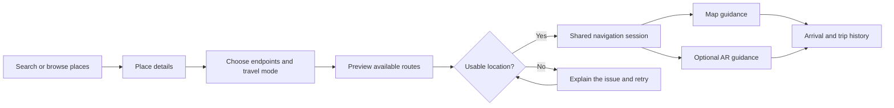
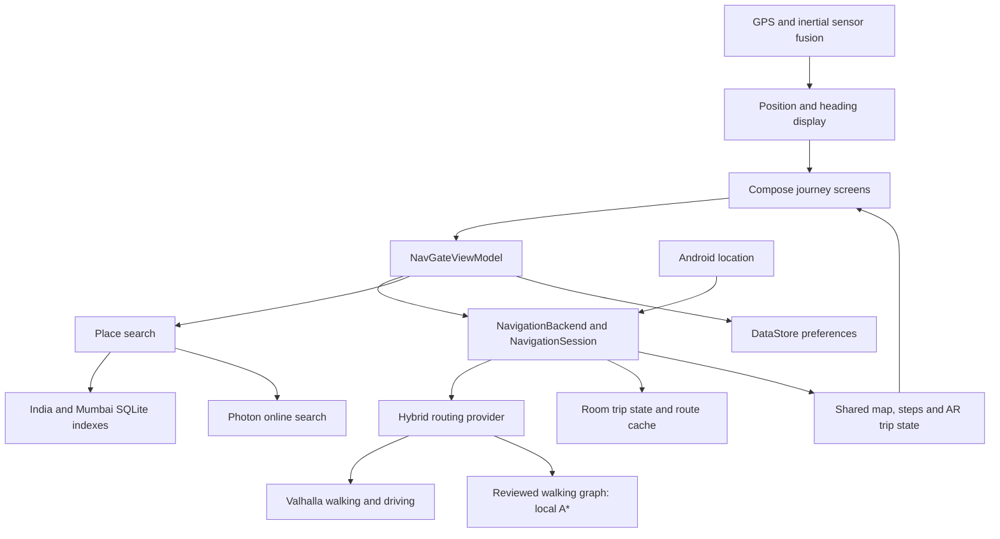

<p align="center">
  
</p>

<h1 align="center">NavGate</h1>
<p align="center"><strong>Find a place. Choose a route. See your next turn.</strong></p>
<p align="center">Native Android navigation · Open map data · Map and augmented reality guidance</p>

## The idea

NavGate is a native Android navigation project that connects place discovery, route planning and turn-by-turn guidance in one experience. Search for a destination, compare walking and driving routes, and follow the same trip on a map or through an augmented reality camera view.

The central idea is to make directions easier to understand in context. A map gives the overview; AR brings the upcoming road and turn into the camera view. Both use the same route, progress and destination, so switching views keeps the trip connected.

India is the focus for offline place discovery, Mumbai has a dedicated points-of-interest dataset, and online search and road routing extend beyond those regions wherever the providers have coverage.

NavGate is being built with Kotlin, Jetpack Compose and open mapping tools, without requiring a paid API key or a cloud account to use its current navigation flow. It remains an actively developed prototype: physical navigation accuracy, AR placement and background reliability require field testing.

## The experience

| Stage | What the user can do |
| --- | --- |
| **Discover** | Search a place, browse nearby categories, revisit recent places or open a saved destination. |
| **Choose** | Inspect a place, select route endpoints, switch between walking and driving, and compare available route choices. |
| **Navigate** | Follow the route with distance, estimated arrival time, maneuver instructions, speech and turn vibrations. |
| **Look ahead** | Switch between map views and optional AR guidance without creating another trip. |
| **Keep** | Save places, label personal itinerary pins, review trip history and save a parking location on arrival. |



### A map that stays part of the journey

The map remains the foundation of the interface. Search results, destination details, route previews and navigation controls appear over it through a shared glass design. Light, dark and system appearances are available, along with adjustable panel transparency and reduced-motion preferences.

MapLibre renders the basemap and route layers. Building footprints can be extruded into 3D where the map data supplies heights. These are solid building shapes; detailed photorealistic building models are outside the current implementation.

### Directions brought into the camera view

The AR implementation draws a road ribbon, moving chevrons and turn markers inside the ARCore camera render frame. It combines camera tracking with geographic position and road heading to align the guidance with the planned route. A checkpoint-based track limits the path prepared ahead of the user.

AR smoothness settings offer Auto, Saver, Smooth and Max modes. The implementation can request 30 or 60 fps camera configurations and use pose prediction for display-rate overlays; the actual rate depends on device support, tracking, temperature and power conditions. A plain-camera fallback is available when ARCore cannot run.

AR alignment remains experimental. It depends on GPS, heading, camera tracking and ground-height estimation. Obstacle detection, depth occlusion and Google Geospatial placement are not implemented.

## How the engineering fits together



| Component | Responsibility |
| --- | --- |
| **Journey UI** | Connected Explore, Search, Place, Directions, Navigation, Arrival and utility screens, using shared state and action contracts. |
| **Navigation core** | Platform-independent route geometry, progress tracking, maneuver progression, GPS-quality checks, arrival, rerouting and recovery. |
| **Route tracking** | Projects position onto the planned route, estimates progress and handles short signal gaps, suspicious fixes and wrong-way movement. |
| **Routing providers** | Valhalla supplies pedestrian and car routes, metrics and maneuvers. Local A* serves eligible reviewed walking graphs. |
| **Discovery** | Local place indexes, online geocoding, aliases, category matching, proximity ranking and duplicate handling. |
| **Android adapters** | LocationManager, inertial sensors, installed offline speech, haptics, navigation notification and foreground service. |
| **Persistence** | Room stores bookmarks, recents, itineraries, history, checkpoints and bounded route caches. DataStore stores preferences. |
| **AR rendering** | ARCore tracking, geographic alignment, road mesh generation and camera-frame rendering; CameraX supports the fallback. |

Routing and tracking use deterministic algorithms. The current app does **not** require an AI model to search its indexes, calculate local paths or advance a navigation session.

## Data, coverage and connectivity

| Source | Purpose | Coverage and limits |
| --- | --- | --- |
| **GeoNames India** | Offline names, alternate names and coordinates | The locally generated snapshot contains **660,027 records**. This is a gazetteer, not a complete list of every business or address. |
| **OpenStreetMap Mumbai POIs** | Nearby categories and place details | The locally generated snapshot contains **13,163 places** in its Mumbai-area bounding box. Details such as hours, phone and website depend on source availability. |
| **Photon** | Online place search and category fallback | Broader discovery wherever indexed data is available. |
| **Valhalla** | Walking/car routes, distance, estimated time and alternatives | Online road routing using mapped roads and paths. Estimates do not include live traffic. |
| **OpenFreeMap / OpenStreetMap** | Map display and building geometry | Tile availability and building detail vary by location. |
| **Reviewed walking packs** | Local walking connectivity and entrances | A destination coordinate alone does not establish a reviewed, accessible walking route. |

The record counts above describe the existing local snapshots. Regenerating the indexes may produce different totals. Search indexes and their manifests are generated assets and are currently ignored by Git.

### What works without a connection

Saved places, personal itineraries and installed place indexes are local. An already planned route can continue supplying guidance during a connection loss. Cached backup routes may help with a deviation when an applicable alternative is already available.

The app also attempts to download map tiles around a planned route. This is a bounded, best-effort corridor download—up to 12 boxes, approximately the first 30 km—not a guarantee that an entire trip is available offline. New road-route requests and reroutes without a suitable cached alternative require a connection. Full offline road routing is future work.

### What “free” means here

The current flow uses open-source libraries and public services without a paid API key. Public routing, search and tile endpoints still have usage policies and availability limits. Their free access does not provide a production uptime guarantee, and operating independent servers would require hardware and maintenance resources.

Online searches and route requests send query or location information to their respective providers. Local storage does not make the online parts of navigation private to the device.

## Run the project

### Requirements

- Android Studio and Android SDK **35**.
- An Android **8.0+ / API 26+** device or emulator.
- A compatible Gradle JDK. The project has used **JDK 22** and targets Java **17** bytecode; the wrapper uses Gradle **8.13**.
- For tracked AR: a compatible physical device with Google Play Services for AR and camera permission.

### Prepare the place data

Generate the India index before building a fresh checkout:

```sh
python3 scripts/build_india_index.py --download
```

For the Mumbai POI index, install `osmium` in your Python environment and provide a suitable Geofabrik extract at the path below:

```sh
python3 scripts/build_poi_index.py --pbf data/osm-extract/western-zone.osm.pbf
```

The POI builder also supports an Overpass-based build when run without `--pbf`; public endpoint availability and rate limits apply. Mumbai POI generation is optional for building the app, but its offline categories require the asset. Keep generated search databases under `app/src/main/assets/search/`.

### Build and launch

Open the repository root in Android Studio, configure the SDK/JDK, sync Gradle and run the `app` configuration on your selected device.

```sh
./gradlew :app:assembleDebug
```

APK output: `app/build/outputs/apk/debug/app-debug.apk`.

For an ARM64-only debug build:

```sh
./gradlew -Pnavgate.abi=arm64-v8a :app:assembleDebug
```

Location is used for current-position guidance; browsing and manual endpoint selection remain available without it. Camera access is requested for AR, and notification permission supports navigation notifications on applicable Android versions. Offline speech requires an installed compatible voice.

## Verification

| Layer | What the tests exercise |
| --- | --- |
| **Core JVM** | Routing, route tracking, session transitions, signal loss/recovery, maneuver behavior and pack integrity. |
| **Android JVM** | Provider parsing and failures, search ranking, ViewModel integration, recorded-route replay and AR geometry/alignment calculations. |
| **Instrumentation** | Native screen actions, persistence, lifecycle behavior and opt-in live-provider/device checks. |
| **Python** | Catalogue and index generation regressions. |

```sh
./gradlew :navigation-core:test :app:testDebugUnitTest
./gradlew :app:connectedDebugAndroidTest
./gradlew :app:lintDebug
python3 -m unittest discover -s scripts/tests -v
```

Live routing checks are opt-in:

```sh
NAVGATE_LIVE_ROUTES=true ./gradlew :app:testDebugUnitTest
```

AR rendering has a separate device smoke test requiring an unlocked, ARCore-compatible phone:

```sh
./gradlew :app:connectedDebugAndroidTest \
  -Pandroid.testInstrumentationRunnerArguments.class=com.rohanc.navgate.ui.ArRenderSmokeTest \
  -Pandroid.testInstrumentationRunnerArguments.ar=true
```

Recorded routes and simulated GPS test the implementation under controlled conditions. They do not establish outdoor accuracy, correct AR placement, reliable process-death recovery or acceptable battery use. Physical walking/driving acceptance, screen-off guidance, interrupted trips, audio and accessibility remain release checks.

## Where the project goes next

| Priority | Scope |
| --- | --- |
| **Navigation reliability** | Validate real walking and driving journeys, junctions, wrong turns, GPS gaps, background behavior and recovery. |
| **AR quality** | Measure road alignment, turn stability, tracking recovery, slopes, thermal behavior and battery use on physical devices. |
| **Offline clarity** | Expose tile-download progress, completion, retry and storage controls; investigate offline road routing. |
| **Useful personal routes** | Connect saved itinerary pins to real multi-stop routing and expand maintained local POI coverage. |
| **Release engineering** | Accessibility, privacy disclosures, signing, automated device checks and sustainable provider access. |

Live traffic, transit, cycling, detailed building models and account-based synchronization are outside the current navigation flow. Future features should build on a dependable walking/driving experience.

## Repository guide

| Directory | Contents |
| --- | --- |
| `app/` | Native Android interface, AR rendering, platform adapters, persistence and integration tests. |
| `navigation-core/` | Kotlin geometry, routing, tracking, session logic and validation independent of Android. |
| `scripts/` | Place-index builders, catalogue tooling and import regressions. |
| `data/` | Source material, mapping snapshots and provenance reports. |
| `docs/` | Technical proposals, contracts, diagrams and implementation notes. |
| `backend/` | Historical optional Go service; the current Android navigation flow does not require it. |

[Routing and search](docs/ROAD_NAVIGATION.md) · [India discovery](docs/INDIA_SEARCH.md) · [Manual itineraries](docs/MANUAL_ROUTES.md) · [Backend contracts](docs/BACKEND_INTEGRATION.md) · [Engineering diagrams](docs/diagrams/README.md) · [Remaining work](docs/REMAINING_WORK.md)

Some technical documents describe earlier implementation phases. Check their dates and the current source when using them as implementation references.

## Attribution

Map and POI data: **© OpenStreetMap contributors**, ODbL. India gazetteer: **GeoNames**, CC BY 4.0. Source attribution and dataset provenance must be retained when generating or distributing data assets.

NavGate builds on MapLibre, OpenFreeMap, Photon, Valhalla, ARCore and the Android/Kotlin ecosystem. Open-source component licenses and data licenses apply independently.
