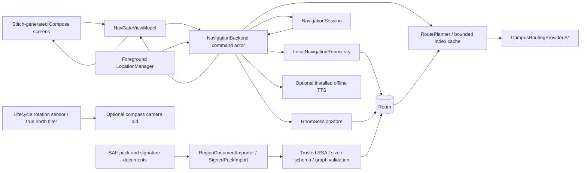
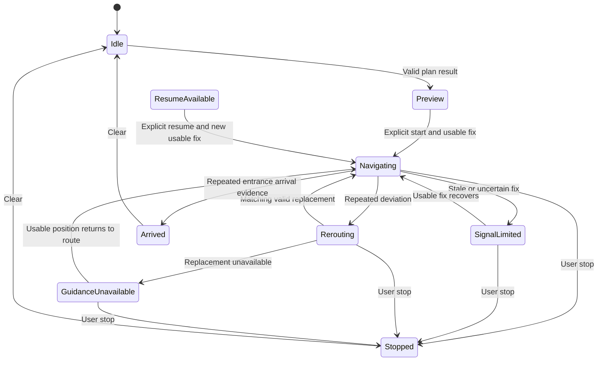
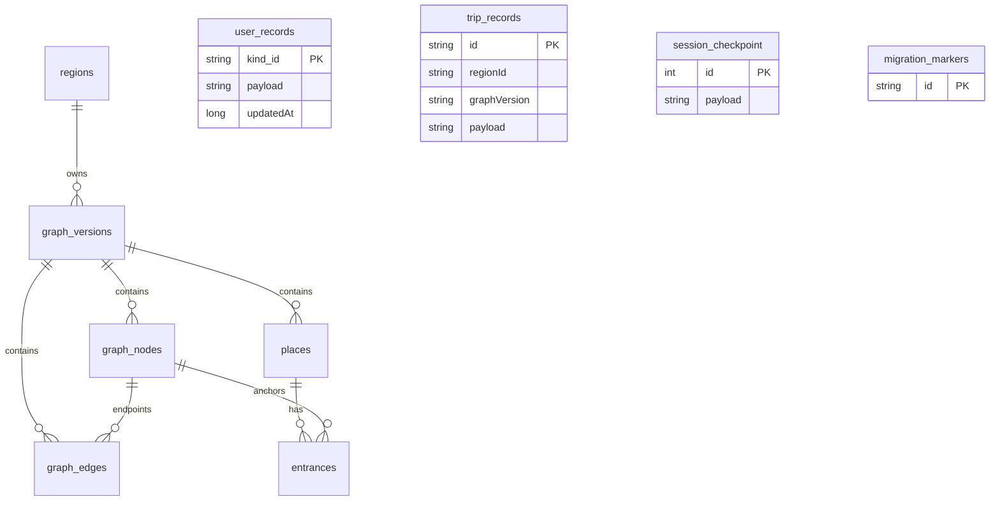

# NavGate backend integration contract

This document describes the implemented local-first Kotlin application engine. `TECHNICAL_PROPOSAL.md` records the design rationale; this contract is the entry point for the future Stitch frontend. The existing Compose screens are an integration shell.

## Runtime ownership

Create services with `NavGateServices.get(applicationContext)`. Create one backend per navigation owner with `services.backend(viewModelScope)`, collect `backend.state` and `backend.announcements`, and call `backend.close()` when that owner is destroyed. The existing `NavGateViewModel` demonstrates that lifecycle. Do not create separate trips for map and camera screens.

The native app has no required account, cloud database, paid API, or hosted routing service. The historical Go service, public OSRM adapter, and fake repository are retained in source but are not production fallbacks for the new local repository. Missing data produces a typed failure.



## Commands and observable state

These are Kotlin calls, not HTTP endpoints. Execute suspend calls in a lifecycle-owned coroutine.

| API | Purpose and result |
| --- | --- |
| `search(query, regionId)` | Latest request wins; bounded local search; `state.places`, `state.destinationAvailability`, `searching` and `storageError` change. Query is capped at 256 characters; the Android store returns at most 40 results by default. |
| `plan(PlanRequest(...))` | Creates a preview or `state.routeFailure`. New endpoints require stopping an active trip. Request generation prevents late results replacing newer selections. |
| `location(LocationFix(...))` | Supplies coordinates, monotonic timestamp, actual accuracy and optional GNSS bearing. Phone orientation comes from sensors separately. |
| `start()` | Requires a fresh accurate fix near the route start. A saved checkpoint requires explicit resume and a new fix. |
| `tick()` | Ages location quality even when no new GPS callback arrives; foreground binding calls it once per second. |
| `stop()` / `clear()` | Invalidate pending routes; stop preserves a history summary and clears the active checkpoint. Clear also dismisses the route. |
| `presentation(Map/CameraAssist)` | Changes presentation without creating or resetting the trip. |
| `retryInitialization()` | Retries local initialization while no trip is active. Corrupt user-bookmark migration does not disable graph/search bootstrap. |
| `regionStatus(regionId)` | Readiness, version, counts, source, attribution, license and supported profiles. Basemap availability is explicitly separate. |

`start`, `stop` and `clear` await an actor barrier. Search and planning return after queueing; observe state for their eventual result. `initializing`, `searching`, and `planning` are separate flags. `durableRevision` increments after successful trip persistence, allowing history screens to refresh. Storage failure is visible and does not disable in-memory guidance.

Destination readiness means `MissingGraph`, `MissingEntrance`, `InvalidGraph`, or `ReviewedEntrance`. A display coordinate alone does not make a place routable. A reviewed entrance still does not guarantee connectivity from a selected origin. The actual planner must decide that. A place can lack a display coordinate yet have a reviewed graph entrance.

Route failures: `MissingRegion`, `MissingGraph`, `UnsupportedProfile`, `InvalidCoordinate`, `MissingEntrance`, `OutsideCoverage`, `UncertainOrigin`, `NoConnection`, `InvalidGraph`. Present their detail and let the user correct the cause. Never draw a straight line or substitute demo data as a successful route.

## Session and location rules

The session statuses are `Idle`, `Preview`, `Navigating`, `SignalLimited`, `Rerouting`, `GuidanceUnavailable`, `Arrived`, `Stopped`, and `ResumeAvailable`. Planning is coordinator state, not a second session owner.

Default usable fixes are at most 8 seconds old and at most 25 metres accuracy. A start must be within 20 metres of the preview start. Segment projection estimates progress; implausible movement is rejected. Persistent deviation requires three samples, with a 12-second reroute cooldown. Reroutes preserve the pinned graph and require matching trip/request metadata. Arrival requires two distinct usable fixes near the destination and route end. These are engineering defaults, not measured guarantees of outdoor accuracy.

Persisted recovery validates geometry, recorded directed edges, destination entrance, costs, progress and immutable graph metadata. Restore offers `ResumeAvailable`; it never treats an old coordinate as a current location. Unreadable or invalid recovery data requires a new trip.



## Persistence and complexity

Room schema version 1 is exported under `app/schemas`. Region activation writes the immutable version, graph records, places, entrances and active pointer in one transaction. Reusing a version ID with different bytes is rejected. Older versions remain available for pinned trips; automatic graph deletion is deliberately absent.



`user_records` snapshots intentionally have no place foreign key, so bookmarks survive catalogue removal. Trip/checkpoint graph existence is enforced by `RoomSessionStore` inside its write transaction. Checkpoints and history are written together. Start and finish timestamps remain stable across repeated persistence. There is no raw GPS-track log.

Saved places are capped at 40, with explicit rejection rather than silent deletion. Recents retain 30. History/trip summaries retain 100. Clear-recents leaves bookmarks intact. Clear-history removes both summary tables; an active checkpoint remains separate and may produce a later summary. SharedPreferences migration is idempotent and preserves the original source values. DataStore migrates region/onboarding/beta preferences.

A* uses a priority queue and adjacency lists: typical worst-case `O((V+E) log V)` time and `O(V+E)` graph/search space, plus stored geometry. Spatial candidate lookup uses a bounded grid; dense/long-segment cases can degrade to scanning candidates. At most two version-specific indexes are retained. Search uses a bounded local SQL substring scan rather than claiming full-text index performance. Batch destination capability calculation is `O(V+E+P+I)` plus validation/geometry work. Recovery uses an edge-ID map, avoiding a full edge scan for every route edge.

## Data and updates

The bundled `regions/kiit-catalog.json` contains 175 real source-list destinations, 84 without coordinates, and **zero reviewed walking edges or entrances**. Bootstrap installs it only when that region has no active pack. Therefore current production KIIT search works locally and routing correctly returns `MissingGraph`. Synthetic routable graphs exist only in tests.

`data/osm/kiit-overpass.json` is the bounded real OSM snapshot. `scripts/build_osm_candidates.py` produces 9,203 candidate nodes and 19,488 directed candidates. Candidates are unreviewed, excluded from the APK, and do not connect building centroids to roads. OSM topology/access review and entrance evidence are required before production navigation. `data/osm/README.md` records the query, source timestamp, restrictions and ODbL attribution. Workbook redistribution rights remain a separate unresolved provenance issue.

`services.regionDocuments.import(regionId, packUri, signatureUri)` accepts content URIs from Android's document picker. The adapter owns both streams, bounds pack input to 8 MiB and signature input to 1 KiB, verifies SHA256withRSA and selected region, validates the pack, and activates transactionally. Cancellation propagates. Failures retain the current graph. Expose its `enabled` and `state` to a future data-management screen.

Updates are **disabled in this checkout** because no publisher trust root has been supplied. A publisher may bundle its RSA public key (at least 2048 bits) as `regions/trusted-update-key.der` in X.509 DER form. The private key stays outside the repository. Documents cannot choose their own public key. For an existing trusted key, sign exact release bytes with:

```sh
openssl dgst -sha256 -sign /secure/location/private-key.pem -out region.sig region.json
```

A new APK can also ship reviewed data. No automated hosting, recurring public endpoint calls, or paid service is required by this implementation.

## Map, camera and speech boundaries

MapLibre remains the renderer. Routing data does not include cached tiles/styles/fonts; offline basemap download is not implemented. A routing graph may work offline while map imagery is missing. The frontend must show that distinction; it must not label an online rendered map as an installed offline pack.

Camera assistance is a compass overlay, not world-anchored AR, obstacle detection or a machine-learning model. Heading uses rotation-vector data, display remapping, geomagnetic declination and circular smoothing, and rejects unreliable/stale samples. Missing sensors, low-quality location and near-maneuver geometry yield recovery guidance. Physical heading alignment is not proven by JVM tests or an emulator.

Speech chooses an installed voice that does not require networking. Missing voice/engine produces an unavailable state and text fallback; speech stops when disabled or backgrounded. No voice download or cloud speech request is started. Real engine/audio output still needs physical-device acceptance.

Platform contracts: [SensorManager](https://developer.android.com/reference/android/hardware/SensorManager), [GeomagneticField](https://developer.android.com/reference/android/hardware/GeomagneticField), [TTS Voice](https://developer.android.com/reference/android/speech/tts/Voice).

## Reproducible verification

Use an installed compatible JDK (the verified host uses Java 22; bytecode targets Java 17), Android SDK 35, and an API 34 test device/emulator:

```sh
./gradlew :navigation-core:test :app:testDebugUnitTest :app:assembleDebug :app:connectedDebugAndroidTest :app:lintDebug --console=plain
python3 -m unittest discover -s scripts/tests -v
python3 scripts/build_osm_candidates.py
```

See `IMPLEMENTATION_STATUS.md` for exact evidence and remaining field limitations. Build output is not proof of a real campus walk, correct gate access, GNSS accuracy, audible TTS, camera alignment, offline map installation, or production readiness. The Go service was preserved without making it a runtime dependency; its test suite requires a separate Go toolchain.

## Native frontend action integration (19 October 2026)

The Compose shell now consumes the existing local `NavGateViewModel`/backend, Room user stores and DataStore preferences. It does not require a new HTTP service. Real catalogue IDs and pinned region versions flow through discovery, endpoint selection, planning, shared map/camera session, arrival and history. The SAF importer retains the existing signature and active-session guards. Unsupported routing data, offline tiles and publisher trust are reported explicitly.

See [FRONTEND_ACTION_AUDIT.md](FRONTEND_ACTION_AUDIT.md) for all 138 reference actions and [FRONTEND_IMPLEMENTATION.md](FRONTEND_IMPLEMENTATION.md) for current test scope and remaining acceptance. Public destination sharing intentionally exports a destination only; it does not serialize a private route or live position.

## Road routing extension — 21 October 2026

`NavigationBackend` accepts an injected `RoutingProvider`; production uses `HybridRoutingProvider`. `PlanRequest` now carries destination coordinates/title and optional sticky routing source. `CampusRoute` retains backwards-compatible defaults and adds profile, provider, fetched time, destination, per-vertex elapsed seconds, warnings and cache state. `source=local_campus_astar` retains graph integrity; `source=valhalla` uses validated road geometry/timing and external checkpoints.

Reroutes preserve mode, destination and provider. Room records preserve driving history without inventing a campus graph FK. The app adapter no longer labels every route walking or divides car distance by walking speed. Search ranking consumes a fresh local location supplier, with no coordinate disclosure to Photon. See [ROAD_NAVIGATION.md](ROAD_NAVIGATION.md) for the engineering flow and operational limits.
