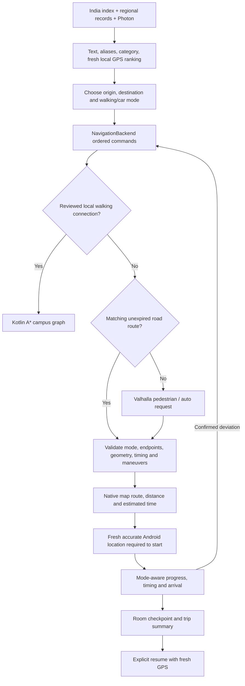

# Walking and driving navigation

NavGate routes coordinate endpoints through Valhalla using `pedestrian` for walking and `auto` for cars. Production services inject this provider into the Kotlin NavigationBackend. A reviewed campus walking graph remains the preferred local provider when the start is inside its coverage and the destination has a reviewed entrance. Other road/path requests use Valhalla. Explicit campus entrances and pinned local reroutes retain their graph contract.

## Data flow

## Provider and metrics

The public demonstration endpoint is `https://valhalla1.openstreetmap.de/route`. Requests identify NavGate using User-Agent and X-Client-Id, serialize requests through a one-second minimum interval, honor 429/503 Retry-After, and support cancellation. There is no paid key. Public endpoints have fair-use limits and no availability guarantee. Before public distribution, follow the operator's request to contact them; the current work does not publish the app or send such a message. The constructor accepts a replacement endpoint for self-hosting.

- Source: https://valhalla.github.io/valhalla/#demo-server
- API: https://valhalla.github.io/valhalla/api/route/api-reference/
- Map data: © OpenStreetMap contributors, ODbL, https://www.openstreetmap.org/copyright

Provider kilometres are converted to metres; provider seconds are retained. Each maneuver's time is distributed over its geometry vertices by distance. Remaining ETA interpolates that timing profile rather than applying walking speed to a car route. It remains an estimate: there is no live traffic feed. The provider's 6-decimal polyline is decoded with size, coordinate and numeric bounds. Invalid/missing geometry, timing, arrival, mode or destination data is rejected; fake/straight-line fallback is never used for directions.

Endpoint matching is limited to 100 m; car endpoint matching excludes ferry edges, and ferry preference is reduced. This does not globally forbid ferries: if a legitimate routed connection includes one, its warning is shown. Pins inside buildings/pedestrian plazas may need moving to a nearby mapped access road/path. If a route starts more than 20 m from the pin, the preview explains that guidance requires moving to the mapped start. Arrival is at the routed endpoint, not a claimed verified building entrance.

## Persistence, guidance and failure handling

Road routes use a separate provider contract from graph-pinned campus paths. Room checkpoints retain provider, requested destination, mode, geometry, timing and trip status without requiring an unrelated campus graph. Restored navigation requires explicit confirmation and fresh GPS; persisted positions never count as live fixes.

GPS freshness, accuracy, jump rejection, repeated deviation evidence, reroute cooldown and repeated arrival fixes apply to both modes. Driving has its own movement plausibility limit. A reroute retains mode and destination, ignores superseded trips, and can join a replacement at the driver's latest plausible position after network latency. Route age/closure uncertainty is visible through provider/cache messages. GPS collection currently follows the visible app lifecycle; continuous background navigation is not provided by a foreground service.

The internal Room cache retains at most 12 provider routes. Keys include provider endpoint, exact origin/destination coordinates, mode, destination ID and region context. Driving TTL is five minutes; walking TTL is fifteen minutes. Cache timestamps survive process restart. Expired/malformed/wrong-mode entries are not returned as fresh directions; failed requests return an explicit unavailable state. An already loaded route can continue displaying and tracking without a new network request, but an uncached reroute needs connectivity. No complete offline road graph is implied.

## Search improvements

The original 660,027-record India gazetteer is unchanged. Search adds bounded FTS and nearby RTree candidates, Latin accent folding while preserving Indic vowel marks, alternate-name relevance, source-coded category matching, and conservative cross-source duplicate handling. Nearby bias requires a valid fix no older than 30 seconds with reported accuracy at most 100 m; stale/invalid fixes do not affect ranking. Coordinates are used locally for ranking and are not sent to Photon. Road routing necessarily sends the chosen route endpoints to the routing provider.

Rank order is text/alias/category relevance, proximity where usable, reviewed/source preference and deterministic candidate order. Same-name branches far apart remain separate; merging nearby cross-source duplicates retains reviewed IDs/entrances. Category coverage is limited to the actual available source tags, not a promise of all businesses.

## Evidence and limitations

Fresh results are recorded in `.qa/runs/20261020T195021Z-road-navigation-essentials-88566a52/`. Real public Mumbai responses captured in test fixtures distinguish 2.042 km / 1485.122 s pedestrian and 2.124 km / 454.199 s auto between the tested road-accessible points near Gateway and Marine Drive. These are request-time source estimates, not measured travel times. Unit/mocked-provider, live HTTP, Room, native UI and emulator GPS evidence must be distinguished. A passing build alone is not road or physical-device acceptance.
