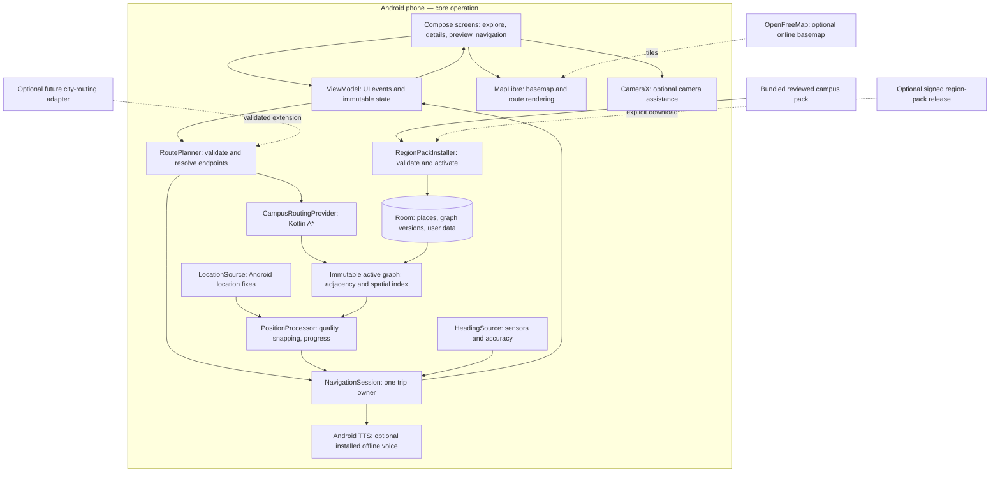
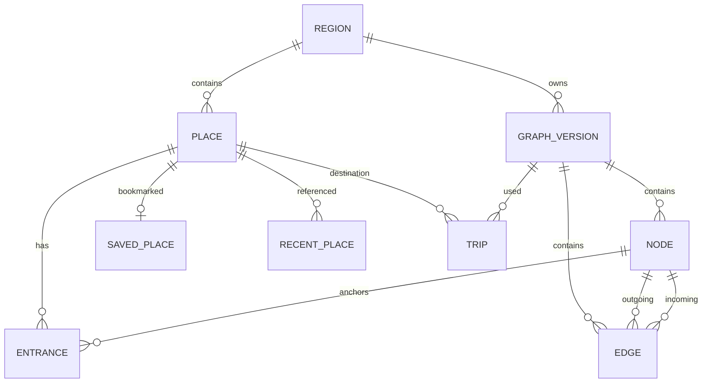
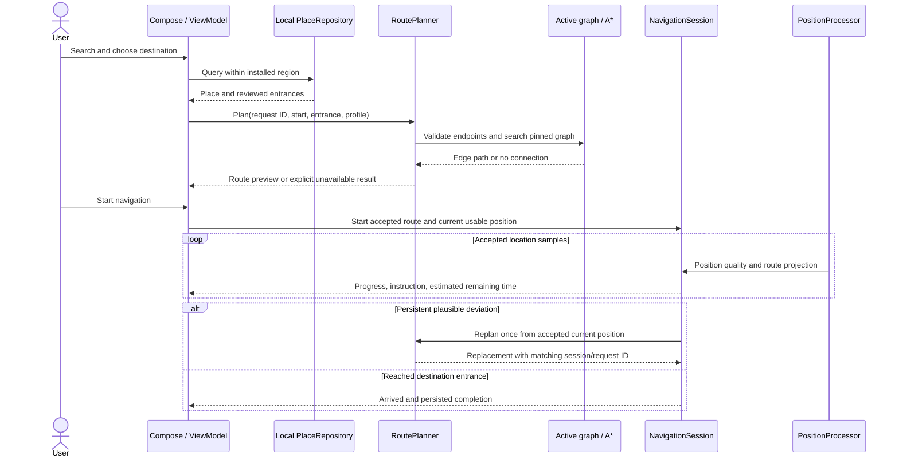
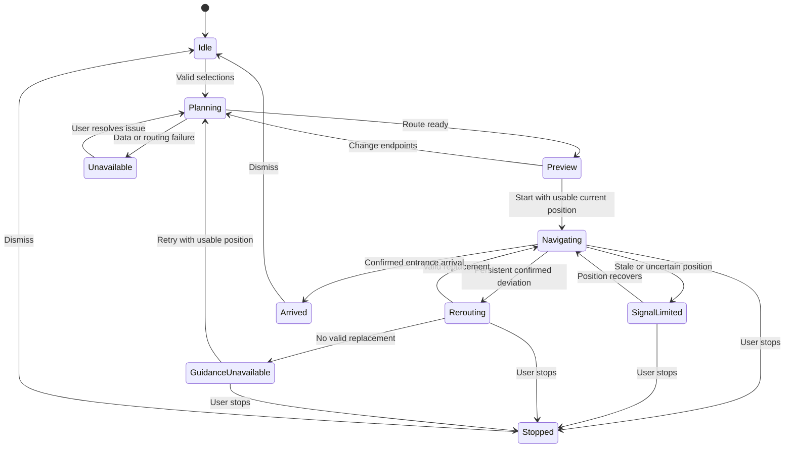
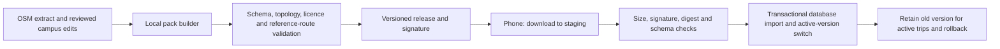

# NavGate technical proposal

**Status: implementation authorized on 18 October 2026 for the Kotlin backend/application engine and app integration. Frontend design is deferred to the user's Stitch workflow. Progress and evidence are tracked in [IMPLEMENTATION_STATUS.md](IMPLEMENTATION_STATUS.md).**  
Implemented contracts and current limitations: [BACKEND_INTEGRATION.md](BACKEND_INTEGRATION.md). Diagrams in this proposal explain the design; the contract describes concrete shipped classes.

Prepared: 18 October 2026. Source baseline: `main`, `7ddd187`. Companion: [current implementation review](PROJECT_UNDERSTANDING.md). Engineering drawing: [architecture.svg](diagrams/architecture.svg).

## 1. The decision in plain language

Build NavGate as a native Kotlin Android application whose core campus navigation works on the phone. A small, versioned campus dataset supplies destinations and real walking connections. A* computes the route locally. One trip controller handles progress, arrival, and recovery; both the map and camera assistance display that same state.

The word “backend” has two meanings here. The **application engine** is the logic behind the screens, running on the phone. A **remote backend** is a server reached over the internet. The first is essential; the second is optional under the zero-paid-service requirement. We should not introduce a compulsory server just because the repository already has one.

No machine-learning model is needed for shortest-path routing. The map renderer draws geographic data; the graph describes legal connections; the routing algorithm searches those connections. Camera positioning is a separate engineering problem.

## 2. Requirements and proposed first scope

User requirements: Kotlin rather than React Native; no paid service dependency; prefer open-source mapping/routing; technical proposal before coding.

Proposed first delivery: a **bounded KIIT outdoor walking pilot**, with local place search, explicit start/destination selection, map preview, live walking guidance, rerouting, arrival, saved places, and usable offline route data. This is a proposed sequencing decision, not a user-approved reduction of the longer-term concept.

The long-term concept still includes Mumbai/city coverage, driving, camera assistance, and potentially indoor navigation. City-driving routing and indoor room/floor positioning require separate validation. They will not be presented as supported merely because a mode exists in the UI. The first pilot requires neither accounts nor cloud sync.

Budget interpretation: no paid APIs, subscriptions, mandatory cloud servers, billing accounts, or card-backed trial dependencies. Development uses existing hardware. Device storage, internet access, electricity, and field mapping still consume resources. A third party's free service can change or fail, so it must not own the core campus route calculation. Distribution starts through locally built APKs; app-store distribution is a separate decision.

## 3. System engineering diagram

Solid arrows below describe proposed runtime flow. Dashed arrows describe optional network resources. None of the proposed new modules is implemented by this document.

The map does not calculate routes. CameraX does not determine geographic position. Room stores data but does not decide where to walk. The NavigationSession is the only component allowed to advance or finish a trip. This prevents map and camera modes from disagreeing about progress.

## 4. Tools and their exact responsibilities

| Tool | What we use it for | What it does not provide | Decision |
| --- | --- | --- | --- |
| Kotlin + Jetpack Compose + Material 3 | Native UI and Android application logic | Routing datasets or geographic precision | Keep current foundation |
| ViewModel + StateFlow + coroutines | Observable UI state, cancellation, background computations | Durable storage or automatic race prevention | Keep; introduce explicit request/session IDs |
| MapLibre Native and its Compose integration | Draw map tiles, route geometry, markers, attribution | Route computation, place search, GPS | Keep; validate dependency pairing before upgrades |
| OpenStreetMap data | Geographic starting material for paths and destinations | Complete campus access, indoor maps, live closures | Use extracts plus reviewed local data |
| OpenFreeMap | Free online basemap and permitted bounded offline resources | Routing, guaranteed uptime | Optional map provider |
| Room / SQLite | Local POIs, graph records, search index, trip summaries, saved places | Remote sync | Add after approval |
| Preferences DataStore | Small settings such as selected region and onboarding | Graph storage or live navigation loop | Migrate existing preferences after approval |
| Kotlin routing core | Graph validation, endpoint resolution, A*, route instructions | Discovery of missing real-world connections | Implement as testable JVM code |
| Android LocationManager behind LocationSource | Framework GNSS fixes without mandatory Play Services | Guaranteed indoor position or precise fixes everywhere | Proposed default for open-source-oriented core |
| SensorManager + coordinate/heading calculations | Heading samples, quality signals, rotation handling | Anchored AR or obstacle detection | Rework existing sensor adapter |
| CameraX | Camera lifecycle and preview | SLAM, floor localization, world anchors | Retain for optional assist mode |
| Android TextToSpeech | Speak maneuver instructions | Guaranteed installed offline voice | Optional; text guidance always remains |
| WorkManager | Deferred pack downloads/validation when appropriate | Real-time GPS or turn-by-turn loop | Add with downloadable packs, not phase-one dependency |
| Python standard library + GeoJSON | Validate/transform reviewed source data into packs | Automatic truth about gates or pedestrian permissions | Extend current scripts |
| Android Studio, JDK 17, Gradle | Development, dependency resolution, builds, emulator | Field acceptance | Existing toolchain; pin compatible versions |
| JUnit, coroutine tests, Room migration tests, Android instrumentation | Algorithm, state, persistence, lifecycle checks | Actual outdoor accuracy | Use alongside device walks |
| Git + GitHub | Version source, reviewed data changes, release artifacts | Unlimited map/download hosting | Existing repo; optional distribution within applicable limits |

Room/DataStore/WorkManager are proposed additions, not installed capabilities in this task. Start with constructor injection rather than adding a DI framework. Use logical packages in the current application plus a pure Kotlin routing module when implementation begins; avoid a large module tree before it is needed.

MapLibre and BRouter are open-source options; OpenStreetMap data has attribution and ODbL obligations. Android devices may contain proprietary firmware or services. “No paid services” does not mean that every part of the operating system or every installed TTS engine is open source.

Existing ARCore and Play Services location dependencies are not necessary to implement the proposed campus graph routing. The proposal removes their mandatory role in the core path, subject to approval and device validation. It does not claim CameraX alone replaces world-tracked AR.

## 5. Backend wireframe: the internal service boundaries

These are proposed Kotlin contracts, not HTTP endpoints. Names are indicative; result types and ownership are the architectural commitment.

| Boundary | Input | Output | Owner and execution |
| --- | --- | --- | --- |
| PlaceRepository.search | Query, region ID, result limit | Matching places with route availability | Room query on IO dispatcher |
| RegionRepository.activeGraph | Region and version | Validated immutable graph | Database load on IO; cached graph per version |
| RoutePlanner.plan | Request ID, origin, destination entrance, profile, graph version | Ready route or typed unavailable reason | Coroutine; CPU work on Default |
| CampusRoutingProvider.route | Valid connected endpoints and walking policy | Ordered directed edges and cost | Pure Kotlin A* |
| NavigationSession.handle | Start/stop event, accepted fix, route replacement | Immutable session state and one-time effects | Single serialized event processor |
| HeadingSource.observe | Lifecycle and permission conditions | Heading, timestamp, accuracy status | Sensor callback adapter |
| RegionPackInstaller.install | Bundled or downloaded pack | Activated version or rejected pack | Staging IO + validation + database transaction |

Use a sealed route result: `Ready(route)` or `Unavailable(reason)`. Reasons include `MissingRegion`, `UnsupportedProfile`, `InvalidCoordinate`, `MissingEntrance`, `OutsideCoverage`, `UncertainOrigin`, `NoConnection`, and `InvalidGraph`. Cancellation is not converted into a fake successful route. The UI gets a clear recovery action for each reason.

A ready route records route ID, request ID, graph version, geometry, directed edge IDs, destination entrance, total distance, estimated duration, maneuvers, provenance, and data-review metadata. Provider provenance is `local_campus_astar` for this engine; route status never inherits a generic “backend” or “high confidence” default.

## 6. Data model and database engineering diagram

| Record | Important fields and rules |
| --- | --- |
| Region | ID, coverage polygon, display name, active version pointer |
| GraphVersion | ID, region, schema version, source dates, validation/review dates, licence and attribution, digest |
| Node | Version + node ID, latitude/longitude, junction or entrance type; finite coordinates in range |
| Edge | Version + edge ID, from/to node, polyline, length, walking access, stairs, access status; directed and nonnegative |
| Place | Stable ID, region, name, aliases, category, optional display coordinate, review status |
| Entrance | Version + entrance ID, place ID, node ID, entrance label and access notes |
| SavedPlace / RecentPlace | Stable place ID, user timestamp; preserve missing-place tombstones across pack updates |
| Trip | Unique trip ID, destination snapshot and stable ID, graph version, started/finished timestamps, status, estimated distance |
| SessionCheckpoint | Trip ID, destination, pinned graph version, last progress and update time; resumable proposal, never proof of current position |

Node and edge keys include graph version to prevent cross-version joins. Enforce foreign keys and validate graph invariants before activation. Persist only reviewed routable edges. Spatial lookup uses an index over edge bounds/segments; loading the bounded graph into adjacency lists avoids querying SQLite for every A* expansion.

Current data is a place list, not a walking graph. The checked-in campus seed has 175 entries, of which 84 lack coordinates. Keep unresolved records available to the data-review workflow; they must not become zero-coordinate destinations. A place can appear as information-only until a reviewed entrance is connected.

## 7. How the graph is built

1. Define a small campus coverage boundary rather than importing all India.
2. Import available OSM paths and current POIs. Preserve source identity and timestamps.
3. Review entrances, gates, crossings, stairs, fences, private/restricted paths, and disconnected components. Confirm uncertain connections through site observation or supplied evidence.
4. Split paths at real junctions. Two lines crossing visually do not necessarily connect: bridges, floors, and barriers need explicit topology.
5. Create directed edges only where movement is allowed. Store full edge geometry, not just endpoint straight lines.
6. Attach destinations to approved entrance nodes. Never connect a building centroid to the nearest road through a wall.
7. Validate coordinates, references, costs, directionality, connectivity, provenance, and licences; generate a routability report.
8. Export a versioned pack and a set of field-test routes. Approval of code cannot substitute for verification of the physical paths.

Unknown access is excluded from the initial trusted routing graph until reviewed. Accessibility routing is not claimed until stairs, slopes, surfaces, and entrance accessibility have adequate data.

## 8. Why A*, and exactly how it works

For the first pilot, optimize **walking distance**. Each permitted directed edge costs its polyline length in metres. A* ranks candidates using `f(n) = g(n) + h(n)`: travelled distance so far plus a straight-line distance lower bound to the destination. Ensure edge lengths are consistent with that lower bound; otherwise use a zero heuristic.

Maintain a min-priority queue, best-known cost per node, and predecessor edges. Relax outgoing edges, ignore obsolete queue entries, and reconstruct the route when the goal is reached. Support cancellation and deterministic tie-breaking. For a bounded graph this is straightforward to inspect and compare with Dijkstra.

Dijkstra uses the same search with `h = 0`. It will serve as an independently coded test oracle for generated small graphs, with manually solved examples as an additional check. A* is not universally faster; measure expanded nodes and actual runtime.

If time optimization is introduced later, use seconds for both `g` and `h`; the heuristic must divide straight-line distance by a justified maximum speed. Never combine metres and seconds. Access restrictions are exclusions, not merely small penalties.

GPS origins normally lie between graph nodes. Resolve them to plausible traversable edge segments using distance, fix uncertainty, direction, and recent progress. Split a selected edge virtually with proportional costs while preserving its allowed directions. Do not invent an off-network connector. If the origin cannot be placed confidently on the network, show the nearest confirmed entry and request a manual start or a better fix.

The engine returns actual edge geometry and entry/exit bearings. A separate maneuver builder creates start, continue, turn, crossing, and arrival instructions. ETA is a walking-speed estimate labelled as such, with no live traffic claim.

## 9. End-to-end route sequence

Search cancels obsolete requests. Route requests include monotonically increasing request IDs; late results cannot overwrite newer destinations. Stopping a trip cancels its pending plan. Reroutes are single-flight with cooldown and session-ID validation. A city/region change requires resolving the current session first rather than silently moving an active trip.

## 10. Live navigation state machine

Presentation is a separate state: `Map` or `CameraAssist`. Changing it never changes the route, step, or trip ID. If camera permission is denied or heading is unreliable, retain map guidance. SignalLimited retains the last route but suspends unjustified progress and arrival claims.

Process restart restores a checkpoint as “resume available”; it obtains a fresh fix and validates the graph before resuming. A preview planned from a manual start remains a preview until the user's current position is compatible with starting it.

The first pilot guarantees guidance while the app is visible. Screen-off/background turn-by-turn support is a later explicit milestone requiring an Android location foreground service, notification, permission handling, and battery testing. WorkManager must not run that real-time loop.

## 11. Position, deviation, and arrival engineering

Use monotonic elapsed time for fix age, horizontal accuracy, plausible motion, and GNSS availability. Reject invalid fixes; do not infer “accurate” from freshness alone. Handle coarse permission as a reduced capability. Manual origin selection still permits planning when location permission is denied.

Project positions onto route segments and measure distance along the route, rather than only distance to stored vertices. Limit progression against previous progress and plausible travel so loops and nearby parallel paths do not cause jumps. Use sustained deviation across usable samples before rerouting. During poor GPS, show uncertainty instead of repeatedly calculating new routes.

Arrival requires proximity to the selected entrance, plausible completion along the route, and sufficient signal quality over more than a single noisy sample. Thresholds depend on field-measured device accuracy and campus geometry; do not copy the current 28 m/45 m constants as acceptance criteria.

Heading alignment must use a consistent reference frame: magnetic heading corrected as needed for geographic bearing, display rotation handled, circular smoothing across 359/0 degrees, and sensor accuracy exposed. At low speed, GNSS movement bearing is not a replacement for phone orientation. A visually aligned ring cannot certify route or location accuracy.

## 12. Offline packs and updates

Treat **routing pack** and **basemap pack** separately. A routing pack includes graph, places, entrances, source metadata, schema version, and validation report. A basemap pack includes permitted tiles, styles, sprites, and fonts. A device can calculate a route without map tiles; in that case show route/instructions and an explicit missing-map state.

Ship one small reviewed routing pack in the APK. Optional updates follow this pipeline:

A digest detects corruption; authenticity requires a signature verified using a trusted bundled public key. Keep signing keys outside the repository. Bound archive sizes and paths, reject unsupported versions, and do not partially activate data. Network failure or disk exhaustion leaves the previous pack intact. Each trip pins its graph version; activate a new version for new trips and clean up unused old versions afterward.

Initially, manual import or a new APK can deliver updated packs. Automated hosting is optional and must be reviewed for download limits. OpenFreeMap currently permits offline downloads within its published 3,000-tile or 50 MB per-download bounds, at most four parallel requests, with an identifying User-Agent. Validate exact terms before implementing downloads. Standard OSM raster tile servers must not be scraped to build offline packs.

## 13. What happens to the existing Go backend?

Preserve it while migrating the core flow. It remains an optional local development/reference service. Do not run an India-scale Docker stack as a prerequisite to testing the campus app.

| Existing component | Proposed treatment |
| --- | --- |
| Compose screens and current ViewModel | Reuse UI; separate orchestration from routing/session ownership |
| NavigationEngine | Refactor behind NavigationSession; improve segment progress and uncertainty |
| BackendNavigationRepository | Split search and routing boundaries; remove public OSRM as automatic primary in campus mode |
| FakeCampusRepository and midpoint fallback | Explicit debug/demo only; never silently become a real route |
| Go POI service and Valhalla/OSRM adapters | Preserve as optional infrastructure; no mandatory deployment |
| SharedPreferences stores | Migrate structured data to Room and preferences to DataStore with regression checks |
| ARCore-required manifest | Make map navigation independent of AR hardware; camera assistance optional |
| Supabase starter policies | Retain as historical optional work; no account/sync dependency in this proposal |

If broader city routing is later approved, evaluate BRouter locally through the same provider boundary. It is Java/Android and MIT licensed, but integration, walking instructions, route quality, data size, and driving restrictions require a prototype. Valhalla on an existing machine is another option if operating that machine is acceptable. Neither integration is claimed complete.

Any future HTTP route API must preserve typed errors and graph/provider provenance. The current endpoints may continue for experiments; they are not silently promoted to a production contract.

## 14. Role of Public APIs

The checked repository [public-apis/public-apis](https://github.com/public-apis/public-apis) is a catalogue, not a backend or navigation SDK. It helps discover optional services, but entries do not establish open-source implementations, unlimited requests, offline operation, or permanent free hosting.

Use local campus search for autocomplete. Do not build it against public Nominatim: its policy forbids autocomplete, limits aggregate application traffic to one request per second, and requires identification, caching as applicable, attribution, and provider switchability. No public API is required for the first pilot's route computation.

## 15. Implementation sequence and acceptance gates

| Phase | Work after architecture approval | Required evidence before progressing |
| --- | --- | --- |
| 0: baseline | Verify toolchain, current Android build/tests, source inventory and migration risks | Recorded results and failures; no claim that old tests prove new design |
| 1: data slice | Choose bounded area; review POIs, entrances, edges; build versioned pack | Routability report, no invalid coordinates, reference paths physically reviewed |
| 2: routing core | Directed graph, snapping, A*, Dijkstra oracle, maneuvers, typed errors | Optimal-cost comparisons, disconnected/one-way tests, cancellation and no invented connectors |
| 3: app integration | Room/DataStore migration, local search, preview, shared session | Device search-to-preview journey; old bookmarks retained; explicit no-route states |
| 4: live guidance | Location quality, segment progress, arrival, single-flight reroute, voice | Real-device campus walks, replayed traces, denied/stale/coarse location and recovery evidence |
| 5: offline and recovery | Basemap pack, atomic updates, checkpoint recovery | Airplane-mode cold launch, interrupted install, rollback, process death and missing-voice checks |
| 6: camera assist | CameraX/sensors sharing session, heading quality, graceful map fallback | Alignment at different rotations, sensor failure, denied camera, trip continuity and battery checks |
| 7: expansion decision | Assess city provider and background guidance; revisit indoor requirements | Bounded integration measurements and a separate scope decision |

Targets to measure, not current results: pilot route planning p95 below 500 ms and local search p95 below 150 ms on a named representative Android device and named pack. Record dataset size, memory, cold/warm behavior, battery impact, and failures. Revise targets if evidence demands it. No claimed accuracy percentage without a defined measurement method and field dataset.

## 16. Failure and recovery contract

| Trigger | Expected behavior |
| --- | --- |
| No internet | Installed graph/search/user data work; basemap works only if its resources are installed |
| No route / unknown entrance | Explain unavailable route; offer another reviewed entrance or start |
| Missing coordinates | Information-only place or data-review issue; never route to 0,0 |
| Bad or stale GPS | Keep route visible, mark signal limited, suspend unsupported progress/arrival |
| New destination while planning | Cancel old work; ignore any late stale response |
| Reroute failure | Explain unavailable replacement; never synthesize a path through barriers |
| Camera/compass unavailable | Map and text navigation remain available |
| Offline TTS voice missing | Text instructions remain; explain voice unavailability |
| Corrupt or interrupted update | Reject staging data; retain working installed pack |
| Out-of-coverage origin | Show coverage boundary and manual planning options; do not imply live guidance there |
| App killed | Offer checkpoint recovery, request fresh location, never silently resume stale guidance |

## 17. Privacy, maintenance, and operational limits

No login or routine coordinate upload is needed for local routing. Online tiles still disclose requested map areas to their provider. Keep trip summaries locally; continuous raw track recording is off by default. Provide deletion controls for saved/history data. Debug traces must be opt-in and sanitized before sharing.

Data maintenance is ongoing engineering: date each pack, preserve attribution, review reported barriers/closures, and show pack age. This pilot does not know live closures automatically. OpenStreetMap-derived databases may have ODbL share-alike obligations on distribution; document dataset licences separately from code licences.

The proposal requires site information to become a dependable campus navigator. We cannot infer indoor floor connectivity, private access, or safe crossings from a POI list. World-anchored AR would need a separate tracking/localization design and device investigation; it is not promised by the camera-assist phase.

## 18. Review checklist

Approval should confirm this specific direction: native Kotlin; bounded KIIT outdoor walking first; on-device A* and local search; optional online basemap; no compulsory remote backend/account; camera assistance after route validation; city driving and indoor/world-anchored navigation as separate later decisions. These are proposal decisions for the user to review, not assumed approvals.

## 19. Primary references

Sources checked on 18 October 2026. Library versions are deliberately not upgraded in a proposal; select compatible pinned versions during baseline verification.

- [Android architecture](https://developer.android.com/topic/architecture): state ownership, layers, repositories and unidirectional flow.
- [Room](https://developer.android.com/training/data-storage/room): SQLite abstraction and structured local storage.
- [DataStore](https://developer.android.com/topic/libraries/architecture/datastore): persistent preferences.
- [MapLibre Native Android](https://maplibre.org/maplibre-native/android/api/): native map rendering/offline interfaces.
- [OpenFreeMap](https://openfreemap.org/): public map service, download bounds and absence of SLA.
- [Android LocationManager](https://developer.android.com/reference/android/location/LocationManager): framework location adapter API.
- [CameraX](https://developer.android.com/media/camera/camerax): Android camera integration.
- [WorkManager](https://developer.android.com/develop/background-work/background-tasks/persistent): persistent deferred work, not a real-time navigation engine.
- [BRouter](https://github.com/abrensch/brouter): candidate offline router.
- [Valhalla Thor](https://valhalla.github.io/valhalla/thor/): mature routing and A* variants.
- [Public APIs](https://github.com/public-apis/public-apis): discovery catalogue.
- [Nominatim policy](https://operations.osmfoundation.org/policies/nominatim/): public-service restrictions.
- [OSM tile policy](https://operations.osmfoundation.org/policies/tiles/): no offline scraping of standard raster servers.
- [OpenStreetMap copyright](https://www.openstreetmap.org/copyright): attribution and data licensing.

The original proposal task created documents and diagrams only. Backend/application-engine implementation was subsequently authorized; see [IMPLEMENTATION_STATUS.md](IMPLEMENTATION_STATUS.md) for current code changes and verification evidence. No field acceptance is established by this proposal.
